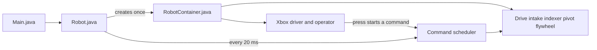
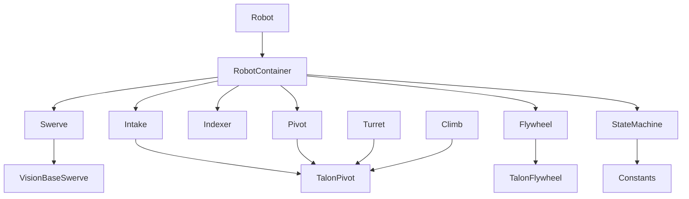
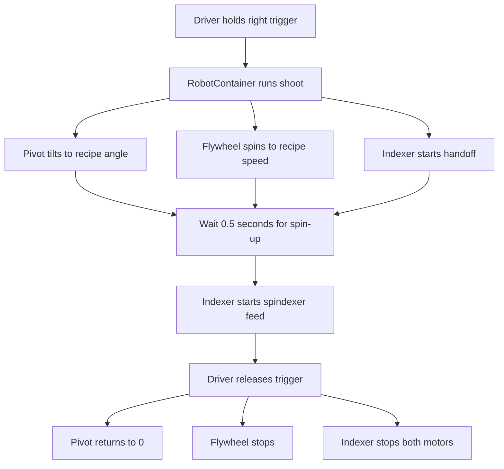
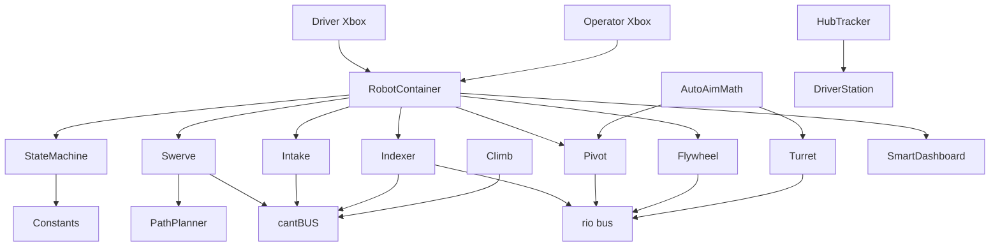

# FRC 2026 robot code (team 1294)

This repository is the software that runs on our competition robot.

**FIRST Robotics Competition (FRC)** is a high-school robotics league. Each year every team builds a robot for a new game. During a match, two alliances of three robots play on a field. This code is for the **2026** season.

If you have never opened this project: start with [What the robot does](#what-the-robot-does), then [How a match works](#how-a-match-works), then [How the software is organized](#how-the-software-is-organized). You do not need WPILib or FRC background to follow those sections.

---

## What the robot does

Think of a factory line on wheels:

1. **Drive** — the robot moves around the field (swerve drive: each corner wheel can roll *and* turn).
2. **Pick up** — a hinged “dozer” at the front can drop to the floor to help collect game pieces (this year’s pieces are called **fuel** / balls).
3. **Index** — motors inside the robot move balls toward the shooter. One motor spins a carousel (**spindexer**). Another motor (**handoff**) is the last roller before the shooter. A light sensor (**beam break**) detects if a ball is sitting in that last stage.
4. **Aim and shoot** — a wrist (**pivot**) tilts the shooter. Two motors (**flywheel**) spin wheels that launch the ball.
5. **Score two ways** — **hub** (shoot into the alliance goal) or **pass** (a longer, flatter shot to a teammate).

Some extra hardware is already written in code but **not plugged into the live controls yet**: a rotating **turret** (aim left/right without turning the whole robot) and a **climb** mechanism (hang at the end of the match).

---

## Words you will see a lot

| Term | Plain meaning |
| --- | --- |
| **roboRIO** | The robot’s onboard computer. This Java program deploys to it. |
| **WPILib** | FIRST’s official robot library (Java). Gives us the match loop, buttons, motors, etc. |
| **Command-based** | Style of WPILib used here: mechanisms are *subsystems*; button presses start *commands* that tell those subsystems what to do. |
| **Subsystem** | One mechanism (drive, shooter, indexer…). Owns its motors. Only one command should drive a given subsystem at a time. |
| **Command** | A recipe: “spin the flywheel, wait, then feed a ball.” Created in `RobotContainer` and in subsystem classes. |
| **Scheduler** | WPILib’s loop that runs every ~20 milliseconds. Starts, continues, and stops commands. |
| **Teleop** | Driver-controlled part of a match (two Xbox controllers). |
| **Autonomous / auto** | First part of a match. The robot runs a pre-chosen routine with no driver input. |
| **Disabled** | Robot is on but not allowed to move (between modes, or e-stopped). |
| **Alliance** | Red or blue. The field is mirrored; some code flips paths for red. |
| **Hub** | The scoring goal. Which hub is “active” can change during the match. |
| **DriverStation / FMS** | Laptop + field system. Sends alliance color, match time, and a short game-data string to the robot. |
| **SmartDashboard** | Live debug screen (numbers, booleans, auto picker) while the robot is running. |
| **CAN bus** | Wiring network motors talk on. Each device has a numeric **CAN ID**. We use two buses: `cantBUS` (drive side) and `rio` (shooter side). |
| **TalonFX** | A specific motor controller (CTRE Phoenix). Almost every motor here is one. |
| **Gyro (Pigeon)** | Sensor that measures which way the robot is facing. Needed for field-oriented driving. |
| **PID / closed loop** | Software that keeps pushing a motor until it reaches a target speed or angle. |
| **Setpoint** | The target number (flywheel speed, wrist angle, climb height). |
| **Singleton** | Only one instance of a class exists. Subsystems are created with `getInstance()`. |
| **poplib** | Our team’s helper library *inside this repo* (not a separate download). Wraps motors, swerve, and Xbox controllers so `frc.robot` stays smaller. |
| **Vendordep** | Third-party library WPILib downloads (Phoenix, PathPlanner, PhotonVision, REV). |

---

## How a match works

```text
Match start
    → Autonomous (~15 s)  robot runs a routine from the dashboard picker
    → Teleop (~2 min)     drivers take over
    → Disabled            match over
```

`Robot.java` is WPILib’s lifecycle class. It has methods that fire when each mode starts (`autonomousInit`, `teleopInit`) and methods that fire every loop (`robotPeriodic`, `teleopPeriodic`).

Every loop, no matter the mode, `robotPeriodic()` runs the **command scheduler**. That is the heartbeat of the whole program.



**During teleop today**

- The drive’s *default command* is always on: left stick moves, right stick rotates.
- Other actions only happen while a button/trigger is held (shoot, flush, drop the dozer).

**What you will see on SmartDashboard**

- Auto chooser (which routine to run when autonomous starts)
- Whether the alliance hub is currently active
- A few flags used for future auto-aim / intake-only modes

---

## How the software is organized

Two Java packages matter:

| Folder | Who owns it | What it is |
| --- | --- | --- |
| `src/main/java/frc/robot/` | This year’s robot | Match wiring, constants, mechanisms, scoring logic |
| `src/main/java/poplib/` | Shared team library | Generic motor/swerve/sensor helpers. Prefer not to change this unless you are updating the library itself. |

### Files to open first

| File | Why it exists |
| --- | --- |
| `Main.java` | Standard Java `main`. Starts WPILib. You almost never edit this. |
| `Robot.java` | Match clock: auto vs teleop vs disabled. Runs the scheduler. Publishes a few dashboard values. |
| `RobotContainer.java` | **The map of the robot.** Creates subsystems, binds Xbox buttons, builds shoot/flush/auto routines. If you wonder “what does this button do?”, start here. |
| `Constants.java` | All magic numbers: motor IDs, PID gains, hub vs pass speeds, climb heights, camera/tag IDs. |
| `subsystems/*.java` | One class per mechanism. Each exposes `Command` methods like `runHandoff()` or `moveWrist(...)`. |
| `utils/StateMachine.java` | Small global “what mode are we in?” object (hub vs pass, climb state, flags). Not a full state machine despite the name. |
| `utils/HubTracker.java` | Decides if *our* hub is the active one right now, using FMS game data + match clock. |
| `utils/AutoAimMath.java` | Geometry + ballistics: “where is the hub, what angle/speed would make the shot?” Written, **not used by the live shoot button yet**. |

### Class map



**Inheritance in one sentence:** `Intake`, `Pivot`, `Turret`, and `Climb` all reuse the same “move this joint to an angle” helper (`TalonPivot` in poplib). `Flywheel` reuses “spin these wheels at a speed.” `Swerve` reuses the team’s drivetrain stack.

### How a button becomes motion

Example: driver holds the **right trigger**.

1. `RobotContainer.configureBindings()` says: on trigger press, run `shoot()`; on release, run `stopShooting()`.
2. `shoot()` is several commands glued together:
   - move the pivot to the current scoring angle
   - spin the flywheel to the current scoring speed
   - start the handoff roller
   - wait 0.5 seconds so the wheels are up to speed
   - start the spindexer so a ball is fed into the wheels
3. The scheduler runs those steps. When the trigger is released, everything returns to idle.

Command glue you will see in code:

| Method | Meaning |
| --- | --- |
| `alongWith(...)` | Run at the same time |
| `andThen(...)` | Run after the previous step finishes |
| `runOnce(...)` | Do this one action (set a motor) and finish |
| `run(...)` | Keep doing this every loop until cancelled or `until(...)` |
| `until(...)` | Stop when a condition is true |
| `raceWith(...)` | Two commands race; when one finishes, both stop |

---

## Mechanisms (hardware + the class that owns them)

### Drivetrain — `Swerve`

Four corner modules (SDS MK4n L2). Each module has a drive motor (speed) and a steer motor (direction). A **Pigeon 2** gyro tells the software which way “forward on the field” is, so pushing the stick “up” always goes toward the far wall, not “the front of the robot.”

Also configured (not the main teleop path):

- **PathPlanner** — a GUI tool for drawing autonomous paths. The swerve class registers “here is how to read pose and drive.”
- **Auto-align** — rotate, then slide sideways using an AprilTag camera so the climb lines up. The camera is commented out, so this is not live.

### Intake — `Intake`

Right now this class only moves a **dozer** (a hinged plate). Hold right bumper to drop it, release to raise it.

Roller motors (IDs 20, 21, 23) are listed in `Constants` but are **not constructed**, so they do not spin yet.

### Indexer — `Indexer`

| Part | Job |
| --- | --- |
| Spindexer motor (CAN 30) | Moves balls around inside the robot toward the shooter |
| Handoff motor (CAN 31) | Last roller into the flywheel |
| Beam break (DIO pin 0) | Light sensor. `ballInHandoff()` is true when a ball is blocking the beam |

“Flush” runs these motors **backwards** (and the flywheel slowly reverse) to spit balls out if something jams.

### Pivot — `Pivot`

The shooter’s wrist. It holds an angle with PID. A **CANdi** (limit-switch hub, ID 44) reports when the wrist hits a hard stop, used for zeroing.

`setLaunchAngle()` is the “real world degrees” helper: it clamps to a safe range (`MIN_ANGLE`–`MAX_ANGLE`) then converts to motor units. The live shoot button currently uses raw motor units from `ScoringSetpoints` instead of this helper.

### Flywheel — `Flywheel`

Two wheels, one motor each. The second motor **follows** the first (same speed, inverted). Target is a velocity (how fast the wheels spin), not a position.

### Turret and climb — written, not wired

`Turret.java` and `Climb.java` exist. In `RobotContainer` the lines that create them are commented out (`// Turret turret = ...`), so buttons do not talk to them yet. When you see dotted arrows in the system diagram, that is why.

### poplib (library layer)

You usually call into this, you do not start here.

| Area | Gives you |
| --- | --- |
| `poplib.motor` | `MotorConfig` → create a TalonFX with current limit, PID, brake/coast |
| `poplib.subsystems.pivot` | Shared “go to this angle” pattern |
| `poplib.subsystems.flywheel` | Shared “spin at this speed” pattern |
| `poplib.swerve` | Module math, odometry (where am I on the field?), teleop drive command |
| `poplib.sensors` | Gyro, cameras, beam breaks, absolute encoders |
| `poplib.controllers.io` | Two Xbox controllers: driver = USB port 0, operator = USB port 1 |

---

## Scoring logic (the “business rules”)

### Two recipes: hub vs pass

`Constants.ScoringSetpoints` is a pair of numbers: wrist target + flywheel target.

| Mode | When to use it | Pivot number | Flywheel number |
| --- | --- | --- | --- |
| `HUB` | Shoot into the goal | `0` | `58` |
| `PASS` | Launch farther to a teammate | `3 * 360` (three motor revolutions) | `95` |

Those numbers are **motor units / closed-loop targets**, not “degrees on a protractor.” They were tuned on the real robot.

The driver picks the recipe with **Y (hub)** or **A (pass)**. That writes `StateMachine.score`. The next right-trigger press reads that value.

### Live shoot sequence



| Control | What the code runs |
| --- | --- |
| Right trigger | `shoot()` — uses hub or pass from `StateMachine` |
| Left trigger | `shootO()` — always the pass-like shot (`3*360` / `95`), ignores the Y/A toggle |
| Left bumper (hold) | `flushRobot()` — reverse indexer + reverse flywheel |
| Right bumper (hold) | Drop dozer; release raises it |

### Is our hub active? (`HubTracker`)

In this game the scoring hub can switch which alliance it belongs to over time. `HubTracker` reads:

1. A short string from the field (`DriverStation.getGameSpecificMessage()`), first letter `R` or `B`
2. How many seconds are left in the match

…and answers “is the currently active hub ours?” `Robot.teleopPeriodic()` shows that as **Hub Active:** on the dashboard. The live shoot button does **not** automatically refuse to shoot if the hub is inactive; this is information for drivers / future logic.

### Auto-aim math (`AutoAimMath`) — future path

Intended closed-loop shot, **not connected to the trigger yet**:

1. From robot pose + alliance, compute heading to the hub (`getTurretSPAngle`).
2. Compute distance to the hub (`getDistance`).
3. Try a table of launch speeds (`VELOS`). For each speed, solve a physics (ballistics) equation for launch angle. First angle that fits the wrist’s min/max wins.

When turret + vision are turned back on, shoot could call this instead of the two fixed recipes.

### `StateMachine` fields

A single shared object. Names are for humans; nothing automatically transitions these enums.

| Field | Meaning today |
| --- | --- |
| `score` | `HUB` or `PASS` recipe |
| `turret` | Intended turret mode (`HUB` / `WALL` / `NONE`) — unused while turret is unwired |
| `climb` | `IDLE` or `EXTENDED_TO_L1` — unused while climb is unwired |
| `enableAutoAim` / `intakeOnly` | Flags shown on the dashboard; related teleop code is commented out |

---

## System design (how the pieces talk)

Read this as: **people → RobotContainer → mechanisms → wires → field tools**.

Turret, Climb, and AutoAimMath exist in code, but `RobotContainer` is not constructing or scheduling them right now.



### Device IDs

Every motor/sensor on CAN must have a unique ID on its bus. These come from `Constants.java`. If a device “doesn’t move,” check the ID in Phoenix Tuner against this table.

| Device | ID | Bus | Used in live teleop? |
| --- | --- | --- | --- |
| Swerve modules | starting at 5 (generated) | `cantBUS` | Yes |
| Pigeon gyro | 19 | `cantBUS` | Yes |
| Intake rollers / follower / guide | 20 / 21 / 23 | listed | No (not constructed) |
| Intake dozer pivot | 22 | `"hi"` | Yes (bumper) |
| Spindexer | 30 | `cantBUS` | Yes |
| Handoff | 31 | `rio` | Yes |
| Indexer beam break | DIO 0 | roboRIO pins | Telemetry (`Ball in Handoff`) |
| Turret | 40 | `rio` | No |
| Pivot | 41 | `rio` | Yes |
| Flywheel lead / follow | 42 / 43 | `rio` | Yes |
| Pivot CANdi | 44 | `rio` | Limit switch |
| Climb | 50 | `cantBUS` | No |

---

## Controller map

Two Xbox controllers. **Driver** drives and shoots. **Operator** can jog individual shooter/indexer motors (useful for testing).

**Driver (port 0)**

| Input | Action |
| --- | --- |
| Left stick | Drive (field-oriented: up on the stick is up-field) |
| Right stick X | Spin in place |
| Right trigger (hold) | Shoot using hub or pass recipe |
| Left trigger (hold) | Pass-like override shot |
| Y | Select hub recipe |
| A | Select pass recipe |
| Right bumper (hold) | Drop dozer |
| Left bumper (hold) | Flush / reverse |
| Start | Reset gyro heading (use if “forward” feels rotated) |

**Operator (port 1)**

| Input | Action |
| --- | --- |
| Right / left trigger | Spin flywheel forward / reverse at a test speed |
| X / B | Handoff forward / reverse |
| A / Y | Spindexer forward / reverse |

---

## Autonomous routines

Before the match, someone picks a routine on **SmartDashboard → Auto Chooser**. When autonomous starts, `Robot` asks `RobotContainer.getAutonomousCommand()` and schedules that choice.

| Name on dashboard | What it does |
| --- | --- |
| Shoot | Spin flywheel to hub speed, handoff, wait, feed with spindexer, wait, stop |
| Shoot And Move | Nudge the drivetrain, then the same shoot sequence |
| GOOOOOOOO | Drive in a straight robot-oriented line (test / leave the starting zone) |
| Dont Shoot | Do nothing |

PathPlanner “named commands” (hooks so a drawn path can say “shoot now”) are in comments and not registered.

---

## How to build and deploy

This is a **WPILib 2026** Gradle project (Java 17, GradleRIO `2026.2.1`).

You can **edit** the code in Cursor or any editor. To **compile, simulate, and load it onto the robot**, use the official [WPILib VS Code install](https://docs.wpilib.org/en/stable/docs/zero-to-robot/step-1/wpilib-setup.html). That installer includes the JDK, GradleRIO, and the WPILib extension. The debug configs in `.vscode/launch.json` only work with that extension.

Typical workflow:

1. Install WPILib VS Code for the 2026 season.
2. Open this folder.
3. Command palette: **WPILib: Build Robot Code**, then **WPILib: Deploy Robot Code** (robot powered, connected over USB or radio).
4. Enable the robot from the Driver Station app, pick an auto, drive.

Team number is `1294` (see `.wpilib/wpilib_preferences.json`).

---

## Suggested first reading order

1. This README (you are here).
2. `RobotContainer.java` — every button and the `shoot()` / `flushRobot()` recipes.
3. `Constants.java` — IDs and hub/pass numbers.
4. `subsystems/Indexer.java` and `subsystems/Flywheel.java` — smallest, easy to follow.
5. `subsystems/Swerve.java` — drivetrain extras (auto, align).
6. `poplib/...` only when you need to know *how* a motor actually gets its PID.
